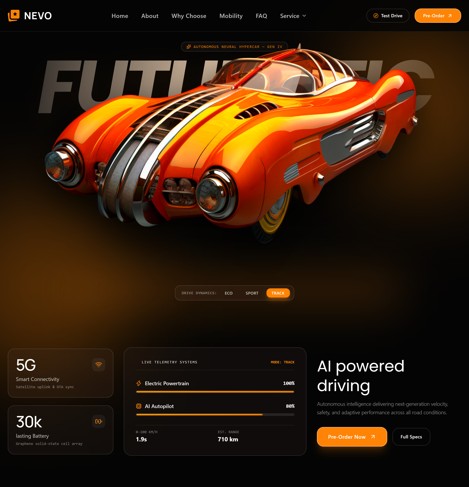
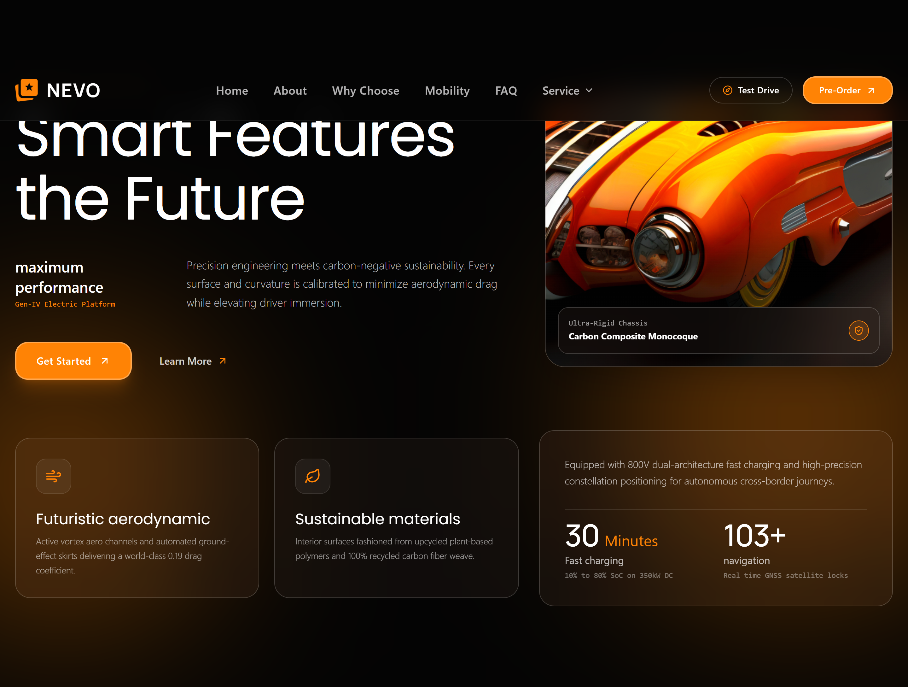
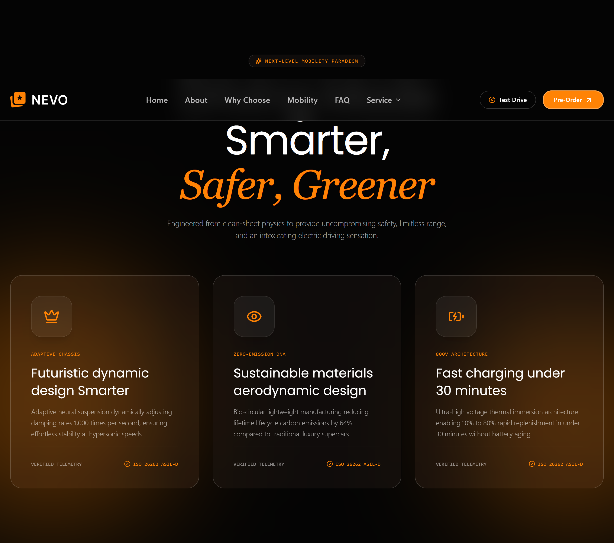
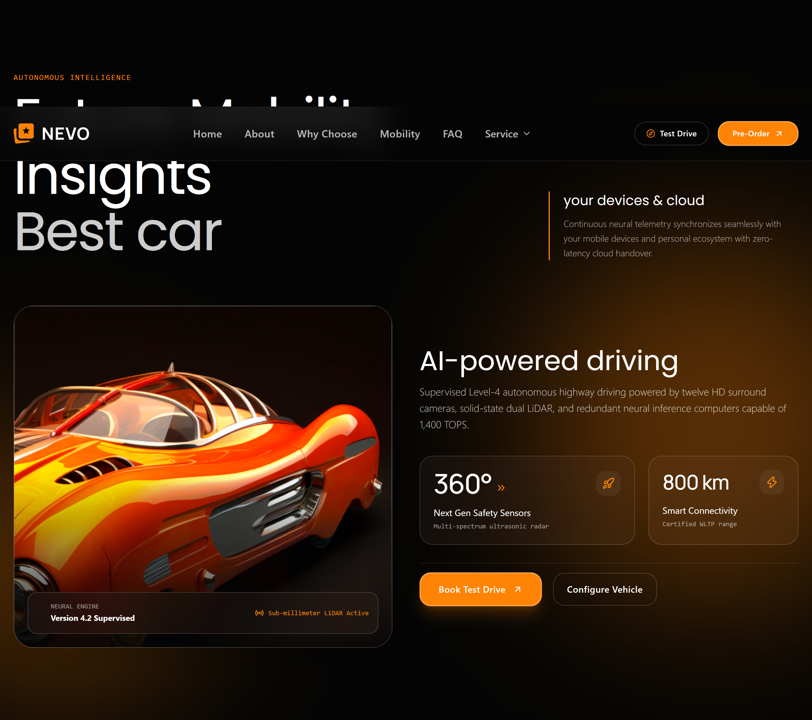
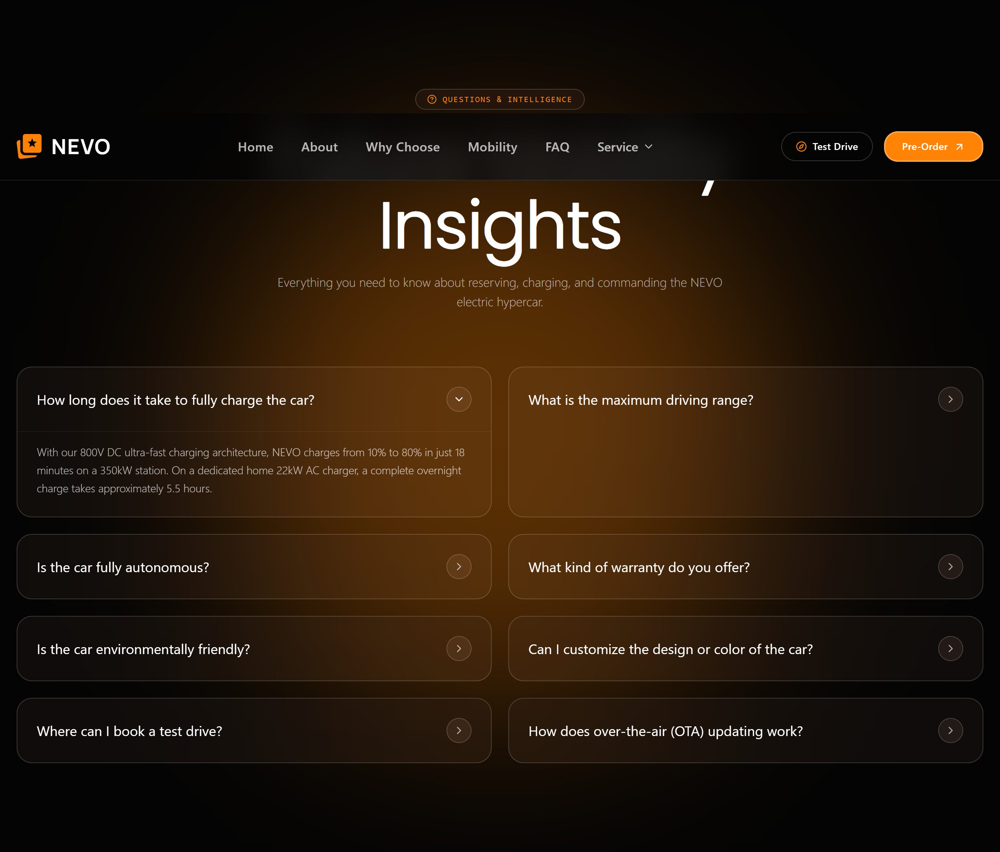
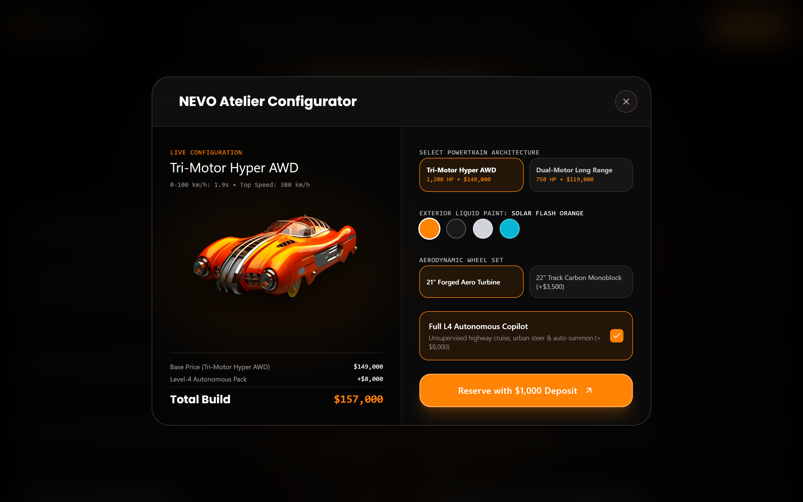
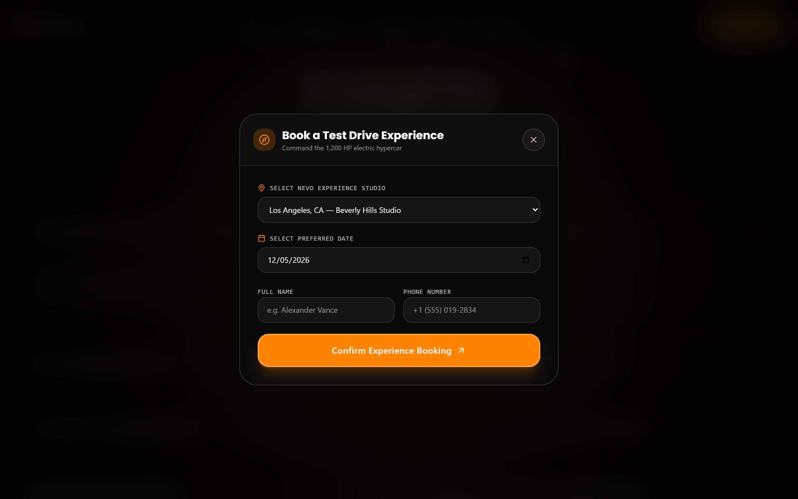

# NEVO — Futuristic Electric Vehicle Experience

> An interactive frontend realization of the NEVO electric automotive landing page concept. Built with **React 19**, **Tailwind CSS v4**, and **Lucide Icons**.

[](https://react.dev/)
[](https://tailwindcss.com/)
[](https://vitejs.dev/)
[](LICENSE)

---

## ⚡ Overview

**NEVO** is a modern web experience showcasing next-generation electric mobility concepts. The interface utilizes an obsidian dark background, energetic amber accents, glassmorphic cards with frosted backdrop blurs, depth typography, and interactive vehicle telemetry controls.

---

## 📸 Visual Showcase & Previews

| View / Section | Preview |
| :--- | :--- |
| **Hero & Depth Typography** |  |
| **Smart Features & Chassis Architecture** |  |
| **Why Choose Mobility Architecture** |  |
| **Autonomous Intelligence & Digital Cockpit** |  |
| **Interactive FAQ Section** |  |
| **Vehicle Configurator Modal** |  |
| **Experience Booking Modal** |  |
| **Full Desktop Page Showcase** |  |
| **Mobile Responsive View** |  |

---

## ✨ Key Features

- **Design System Fidelity**: Implements dark aesthetics, ambient lighting, glassmorphic cards, and high-resolution vehicle visuals.
- **Dynamic Drive Dynamics**: Interactive selection between Eco, Sport, and Track modes with responsive telemetry sliders.
- **Interactive Configurator Drawer**: Configure powertrain variations, paint choices, wheel designs, and autonomous assistance packages with real-time price estimation.
- **Experience Booking Modal**: Schedule showroom visits with location and date selection.
- **Accordion FAQ**: Interactive questions and answers covering battery charging, range, and technology.
- **Responsive Layout**: Designed for smooth viewing across desktops, laptops, tablets, and mobile devices.

---

## 🛠️ Tech Stack

- **Framework**: React 19
- **Build Tool**: Vite 8
- **Styling**: Tailwind CSS v4
- **Icons**: Lucide React
- **Fonts**: Poppins & Manrope

---

## 🚀 Getting Started

### Installation

```bash
# Clone the repository
git clone https://github.com/lxlnimalxl/nevo-futuristic-car-website.git

# Navigate into the project directory
cd nevo-futuristic-car-website

# Install dependencies
npm install

# Start development server
npm run dev
```

### Production Build

```bash
# Build for production
npm run build

# Preview build locally
npm run preview
```

---

## 📄 License

This project is licensed under the [MIT License](LICENSE).
